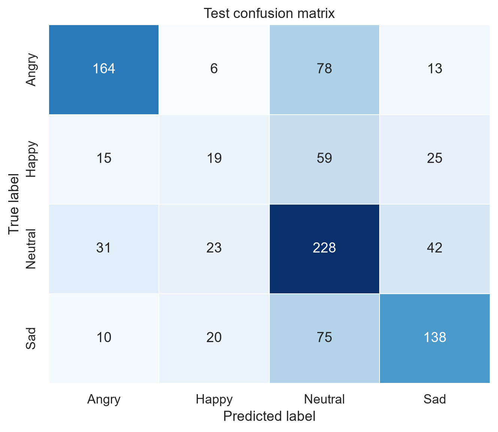

# Speech Emotion Recognition

Recognizing **angry, happy, neutral and sad** speech with MFCC features and one-dimensional convolutional networks. This university NLP project compares random and speaker-independent splits, then explores architecture and feature choices across six saved experiments.

**Python · PyTorch · librosa · pandas · scikit-learn**

[گزارش فارسی](doc/report_fa.md) · [All experiment results](doc/tables/experiment_results.md)



## What the project includes

- Audio duration and label-distribution analysis for the selected IEMOCAP subset.
- MFCC extraction, optional delta/delta-delta features, and fixed-length sequences.
- Plain and residual 1D CNN implementations.
- Random and speaker-independent evaluation, with head/tail truncation and masking variants.
- Training histories, confusion matrices, per-class results and the best checkpoint from each experiment.
- A command-line predictor for individual WAV files.

## Recorded results

These values are retained from the original project experiments. They summarize different evaluation settings, so the split should be reported alongside each score.

| Split | Architecture | Accuracy | Weighted F1 |
| --- | --- | ---: | ---: |
| Random | Plain 1D CNN | 0.6514 | 0.6516 |
| Speaker-independent | Plain 1D CNN | 0.5803 | 0.5718 |
| Speaker-independent | Residual 1D CNN | 0.5729 | 0.5371 |

The [Persian report](doc/report_fa.md) discusses the split comparison, class-level behavior and all six runs. Machine-readable results are in [`doc/tables/experiment_results.csv`](doc/tables/experiment_results.csv).

## Setup and prediction

The original project documents Python 3.11 or 3.12. Run these commands from the repository root in Windows PowerShell:

```powershell
py -3.12 -m venv .venv
.\.venv\Scripts\python.exe -m pip install -r code\requirements.txt
```

The saved speaker-independent model is included, so prediction does not require downloading the training dataset:

```powershell
.\.venv\Scripts\python.exe code\predict.py doc\experiments\speaker_plain_mfcc_head\best_checkpoint.pt path\to\sample.wav
```

Replace `path\to\sample.wav` with an audio file. The other five best checkpoints are stored in their corresponding experiment directories.

## Data and training

Raw audio, downloaded shards and feature caches are excluded. The original data source and label mapping are documented in the report; `code/download_data.py` contains the configured download workflow.

```powershell
.\.venv\Scripts\python.exe code\download_data.py
.\.venv\Scripts\python.exe code\prepare_data.py
.\.venv\Scripts\python.exe code\extract_features.py --workers 4
.\.venv\Scripts\python.exe code\run_experiments.py --include-optional
.\.venv\Scripts\python.exe code\summarize_results.py
```

For one experiment:

```powershell
.\.venv\Scripts\python.exe code\train_model.py --architecture plain --feature-mode mfcc --split-strategy speaker --truncation head
```

## Repository layout

| Path | Contents |
| --- | --- |
| [`code/ser/`](code/ser/) | Data preparation, feature extraction, models and training modules |
| [`code/predict.py`](code/predict.py) | WAV-file inference using a saved checkpoint |
| [`doc/report_fa.md`](doc/report_fa.md) | Full analysis in Persian |
| [`doc/experiments/`](doc/experiments/) | Six experiment records and best checkpoints |
| [`doc/figures/eda/`](doc/figures/eda/) | Dataset overview figures |
| [`doc/tables/`](doc/tables/) | Summary statistics and result tables |
| [`code/tests/`](code/tests/) | Tests included with the original project |

Developed as university coursework in natural language processing. Scores above describe the saved project runs.
