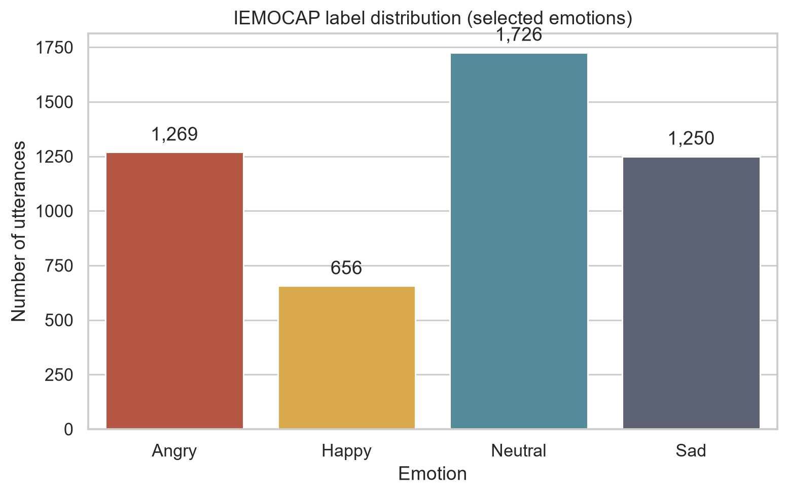
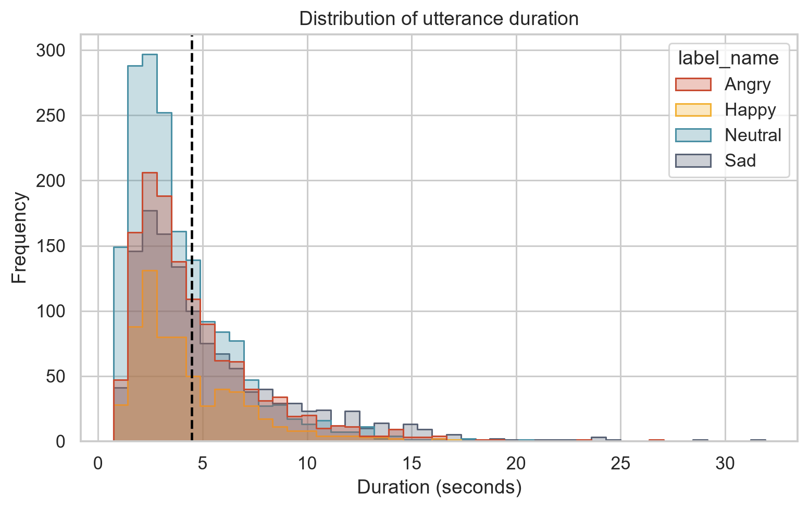
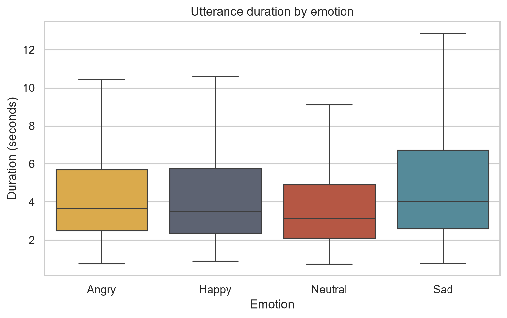
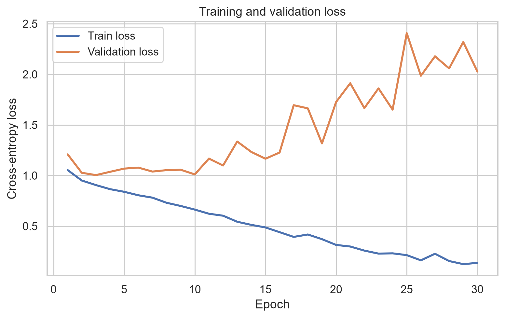
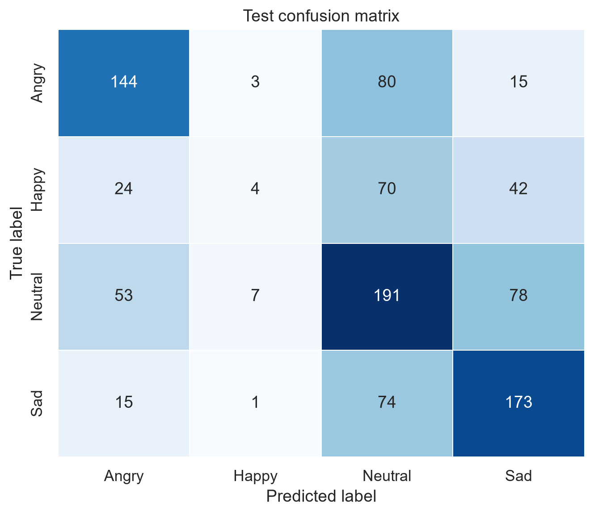
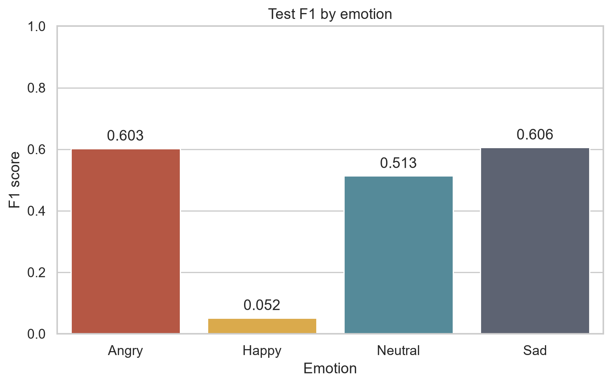

# گزارش پروژهٔ بازشناسی احساس از ماهیت صوت

**درس:** پردازش زبان طبیعی  
**تاریخ اجرا:** ۱۴۰۵/۰۵/۰۳

> **اصلاحیه، آبان ۱۴۰۵:** نسخهٔ اول گوینده را از نام دیالوگ می‌خواند، نه از خود گفتار؛ برای همین بخشی از صداهای مجموعهٔ آزمون در آموزش هم بودند و دقت روی گوینده‌های ناشنیده `0.5803` گزارش شد. تقسیم‌بندی و هر شش آزمایش با شناسهٔ درست گوینده دوباره اجرا شد: دقت `0.6667` روی تقسیم تصادفی و `0.5257` روی گوینده‌های ناشنیده (گوینده‌های آزمون Ses02F و Ses03M). اعداد به‌روز در [README](../README.md) و [جدول نتایج](tables/experiment_results.md) است؛ متن زیر تحلیل نسخهٔ اول است.

## چکیده

در این پروژه بازشناسی چهار احساس Angry، Happy، Neutral و Sad از سیگنال
گفتار مجموعه‌دادهٔ IEMOCAP بررسی شد. ویژگی پایه ۴۰ ضریب MFCC و مدل اصلی یک
شبکهٔ کانولوشنی یک‌بعدی سه‌بلوکی است. برای سنجش اثر نشت هویت گوینده، دو
تقسیم‌بندی تصادفی و بدون هم‌پوشانی گوینده مقایسه شدند. در تقسیم تصادفی مدل
Plain 1D CNN به دقت `0.6514` و F1 وزنی `0.6516` رسید، ولی همین مدل در
تقسیم‌بندی واقع‌بینانه‌ترِ بدون نشت گوینده به دقت `0.5803` و F1 وزنی
`0.5718` رسید. این افت، خوش‌بینانه‌بودن ارزیابی utterance-level تصادفی را
نشان می‌دهد.

در تقسیم بدون نشت، مدل Plain بهتر از Residual عمل کرد. تحلیل ماتریس
درهم‌ریختگی نشان داد Happy سخت‌ترین کلاس است؛ F1 این کلاس تنها `0.2043`
بود و بیشتر نمونه‌های آن Neutral پیش‌بینی شدند. نمودارهای آموزش نیز
بیش‌برازش شدید پس از چند دوره را نشان می‌دهند. تمام اعداد این گزارش از
اجرای واقعی با seed برابر ۴۲ روی RTX 3060 به‌دست آمده‌اند.

## ۱. داده و تحلیل اکتشافی

داده از مخزن معرفی‌شده در صورت پروژه دریافت شد:
[AbstractTTS/IEMOCAP](https://huggingface.co/datasets/AbstractTTS/IEMOCAP).
سه shard با مجموع ۱۰٬۰۳۹ سطر و حجم حدود ۱٫۴۱ گیگابایت بررسی شدند. پس از
نگه‌داشتن تنها چهار احساس خواسته‌شده، ۴٬۹۰۱ گفتار باقی ماند.

| شناسه | احساس | تعداد | درصد |
|---:|---|---:|---:|
| ۰ | Angry | ۱٬۲۶۹ | ۲۵٫۸۹٪ |
| ۱ | Happy | ۶۵۶ | ۱۳٫۳۹٪ |
| ۲ | Neutral | ۱٬۷۲۶ | ۳۵٫۲۲٪ |
| ۳ | Sad | ۱٬۲۵۰ | ۲۵٫۵۰٪ |



آمار مدت‌زمان فایل‌های انتخاب‌شده:

| آماره | مقدار |
|---|---:|
| میانگین | ۴٫۴۸۱ ثانیه |
| انحراف معیار نمونه | ۳٫۱۳۶ ثانیه |
| کمینه | ۰٫۷۳۰ ثانیه |
| بیشینه | ۳۱٫۹۱۰ ثانیه |
| مجموع | ۶٫۱۰۱ ساعت |





### اثر عدم توازن برچسب‌ها

Neutral حدود ۲٫۶۳ برابر Happy نمونه دارد. در Cross Entropy بدون وزن‌دهی،
کلاس‌های پرتعداد سهم بیشتری در گرادیان دارند؛ بنابراین مدل می‌تواند با
تمایل به Neutral مقدار loss و Accuracy کلی را بهتر کند، ولی recall کلاس
Happy را از دست بدهد. نتیجهٔ واقعی نیز همین الگو را نشان داد: در بهترین
مدل speaker-disjoint، ۵۹ نمونه از ۱۱۸ نمونهٔ Happy به‌صورت Neutral
پیش‌بینی شدند. به همین علت علاوه بر Accuracy و F1 وزنی، Macro F1 و F1 هر
کلاس نیز گزارش شده‌اند. برای حفظ خط پایهٔ خواسته‌شده، نتایج اصلی بدون
class weighting هستند؛ پیاده‌سازی گزینهٔ `--class-weighting balanced` را
برای آزمایش تکمیلی دارد.

## ۲. تقسیم‌بندی داده

### ۲.۱. تقسیم تصادفی

تقسیم با stratification بر اساس برچسب و seed برابر ۴۲ انجام شد:

| زیرمجموعه | تعداد | نسبت |
|---|---:|---:|
| آموزش | ۳٬۴۳۰ | ۶۹٫۹۹٪ |
| اعتبارسنجی | ۴۹۰ | ۱۰٫۰۰٪ |
| آزمون | ۹۸۱ | ۲۰٫۰۲٪ |

هر ده گوینده در هر سه بخش حضور دارند. بنابراین شبکه ممکن است ویژگی‌های
ثابت گوینده مانند pitch پایه، جنسیت، سبک بیان یا شرایط ضبط را یاد بگیرد و
آن‌ها را در آزمون دوباره ببیند. این تقسیم برای مقایسه با حالت رایج حفظ شد،
اما برآورد کاملاً مستقلی از تعمیم به گویندهٔ جدید نیست.

### ۲.۲. تقسیم بدون هم‌پوشانی گوینده

از نام فایل، شناسه‌هایی مانند `Ses01F` و `Ses01M` استخراج شدند. چون ده
گوینده وجود دارد، هفت گوینده برای آموزش، یک گوینده برای اعتبارسنجی و دو
گوینده برای آزمون انتخاب شدند. تمام حالت‌های ممکن ۷/۱/۲ جست‌وجو شدند و
حالتی انتخاب شد که خطای نسبت نمونه‌ها و فاصلهٔ توزیع کلاس‌ها از توزیع کلی
را کمینه کند؛ نبود یک کلاس نیز جریمهٔ بزرگ داشت.

| زیرمجموعه | گوینده‌ها | تعداد | نسبت |
|---|---|---:|---:|
| آموزش | Ses01F, Ses01M, Ses02F, Ses02M, Ses03F, Ses03M, Ses04F | ۳٬۴۲۹ | ۶۹٫۹۷٪ |
| اعتبارسنجی | Ses05M | ۵۲۶ | ۱۰٫۷۳٪ |
| آزمون | Ses04M, Ses05F | ۹۴۶ | ۱۹٫۳۰٪ |

به‌دلیل گسسته‌بودن تعداد گوینده‌ها، نسبت‌ها نمی‌توانند دقیقاً ۷۰/۱۰/۲۰
باشند. یک گوینده در اعتبارسنجی نزدیک‌ترین انتخاب به ۱۰ درصد است. هر چهار
کلاس در هر سه زیرمجموعه موجودند و هیچ شناسهٔ گوینده‌ای بین آن‌ها مشترک
نیست.

### نتیجهٔ مقایسهٔ دو تقسیم

| تقسیم | مدل | Accuracy | F1 وزنی | Macro F1 |
|---|---|---:|---:|---:|
| تصادفی | Plain | ۰٫۶۵۱۴ | ۰٫۶۵۱۶ | ۰٫۶۲۲۴ |
| بدون نشت گوینده | Plain | ۰٫۵۸۰۳ | ۰٫۵۷۱۸ | ۰٫۵۲۰۴ |

افت ۷٫۱۱ واحد درصدی Accuracy و ۷٫۹۸ واحد درصدی F1 وزنی نشان می‌دهد بخشی
از عملکرد تقسیم تصادفی ناشی از شباهت گوینده‌های آموزش و آزمون است. نتیجهٔ
speaker-disjoint معیار قابل اتکاتری برای کاربرد روی کاربر جدید است.

## ۳. پیش‌پردازش و ویژگی‌ها

### ۳.۱. استخراج MFCC

صوت به mono و نرخ نمونه‌برداری ۱۶ کیلوهرتز تبدیل شد. برای هر گفتار:

- `n_mfcc = 40`
- `hop_length = 512`
- MFCC ایستا با شکل `(40, T)`
- مشتق مرتبهٔ اول و دوم، هرکدام با شکل `(40, T)`
- نمایش کامل اختیاری با شکل `(120, T)`

اجرای پایه فقط ۴۰ ضریب MFCC را استفاده می‌کند. آرایهٔ ۱۲۰ کاناله یک‌بار
کش شد و مدل پایه view مربوط به ۴۰ کانال اول را می‌خواند؛ بنابراین مقایسه
MFCC-only و MFCC+delta+delta-delta دقیقاً روی گفتارهای یکسان است.

### ۳.۲. یکسان‌سازی طول

`max_len=300` در نظر گرفته شد. تعداد ۴٬۵۴۵ گفتار کوتاه‌تر بودند و در انتها
zero padding شدند؛ ۳۵۶ گفتار طولانی‌تر بودند و برش خوردند. دو کش مستقل از
یک استخراج مشترک ساخته شد:

- `head`: ۳۰۰ قاب ابتدایی را نگه می‌دارد؛
- `tail`: ۳۰۰ قاب پایانی را نگه می‌دارد.

نتیجهٔ مدل Plain روی تقسیم speaker-disjoint:

| قسمت نگه‌داری‌شده | Accuracy | F1 وزنی | Macro F1 |
|---|---:|---:|---:|
| ابتدای گفتار | ۰٫۵۸۰۳ | ۰٫۵۷۱۸ | ۰٫۵۲۰۴ |
| انتهای گفتار | ۰٫۵۶۸۷ | ۰٫۵۶۵۹ | ۰٫۵۱۷۱ |

نگه‌داشتن ابتدا در مجموع اندکی بهتر بود. این نتیجه نشان می‌دهد اطلاعات
احساسی فقط در پایان utterance متمرکز نیست و حذف ابتدای گفتار می‌تواند onset
لحن و انرژی را از بین ببرد. با این حال F1 کلاس Happy در حالت tail از
`0.2043` به `0.2180` رسید؛ پس مکان نشانه‌های احساسی بین کلاس‌ها یکسان
نیست.

### ۳.۳. zero padding، Global Average Pooling و mask

پس از نرمال‌سازی، قاب‌هایی که پیش از نرمال‌سازی صفر بوده‌اند لزوماً صفر
نمی‌مانند. همچنین کانولوشن می‌تواند در مرز گفتار و padding فعال شود. در
Global Average Pooling معمولی، این مقادیر در میانگین نهایی حضور دارند و
نمایش گفتارهای کوتاه را تغییر می‌دهند.

در آزمایش اختیاری، طول معتبر هر گفتار پس از سه MaxPool به‌روزرسانی شد و
فقط موقعیت‌های معتبر در میانگین نهایی شرکت کردند:

| روش pooling | Accuracy | F1 وزنی | Macro F1 |
|---|---:|---:|---:|
| GAP معمولی | ۰٫۵۸۰۳ | ۰٫۵۷۱۸ | ۰٫۵۲۰۴ |
| GAP ماسک‌دار | ۰٫۵۵۶۰ | ۰٫۵۴۴۹ | ۰٫۴۹۳۷ |

mask در این اجرا بهتر نشد. یک تفسیر ممکن این است که طول گفتار خود نشانه‌ای
احساسی است و مدل پایه از الگوی padding به‌طور ضمنی استفاده کرده است.
همچنین mask فقط pooling نهایی را اصلاح می‌کند و اثر padding بر receptive
field کانولوشن‌های نزدیک مرز را حذف نمی‌کند. پس نتیجه به معنی بی‌فایده‌بودن
mask در همهٔ معماری‌ها نیست.

### ۳.۴. نرمال‌سازی

میانگین و انحراف معیار هر کانال تنها با داده‌های آموزش و روی محور نمونه و
زمان محاسبه شد. همان آمار بدون محاسبهٔ مجدد روی validation و test اعمال
شد. تفاوت دامنهٔ MFCC، delta و delta-delta می‌تواند گرادیان بعضی کانال‌ها
را غالب و یادگیری کانال‌های کوچک‌تر را دشوار کند؛ نرمال‌سازی per-channel
این مشکل را کاهش می‌دهد.

استفاده از کل داده برای محاسبهٔ آمار، اطلاعات توزیعی validation و test را
پیش از آموزش وارد pipeline می‌کند و data leakage است. حتی بدون استفاده از
برچسب، مدل در فضایی مقیاس‌بندی می‌شود که به توزیع آزمون آگاه است و ارزیابی
دیگر کاملاً مستقل نیست.

### ۳.۵. مشتق‌های مرتبهٔ اول و دوم

مشتق‌ها زمانی مفیدند که نحوهٔ تغییر pitch، انرژی یا طیف مهم‌تر از مقدار
ایستای آن باشد؛ برای مثال تغییر سریع لحن، کشیده‌شدن واژه و transitionهای
هیجانی. در مقابل، یک CNN زمانی می‌تواند بخشی از این اختلاف‌های محلی را
خود بیاموزد. روی دادهٔ کوچک، افزودن کانال‌ها تعداد پارامترها و احتمال
بیش‌برازش را افزایش می‌دهد.

| ورودی Plain | کانال | Accuracy | F1 وزنی | Macro F1 | بهترین دوره |
|---|---:|---:|---:|---:|---:|
| MFCC | ۴۰ | ۰٫۵۸۰۳ | ۰٫۵۷۱۸ | ۰٫۵۲۰۴ | ۱۶ |
| MFCC + delta + delta-delta | ۱۲۰ | ۰٫۶۰۰۴ | ۰٫۵۶۳۰ | ۰٫۴۸۵۷ | ۲ |

مشتق‌ها Accuracy را بالا بردند، اما F1 وزنی و به‌ویژه Macro F1 را کاهش
دادند. مدل ۱۲۰ کاناله هیچ نمونه‌ای را Happy پیش‌بینی نکرد و F1 این کلاس
صفر شد. بنابراین افزایش Accuracy ناشی از بهبود متوازن همهٔ کلاس‌ها نیست.

## ۴. معماری مدل‌ها

### ۴.۱. Plain 1D CNN

سه بلوک متوالی استفاده شد:

1. `Conv1d(input, 64, kernel=3, stride=1, padding=1)`، BatchNorm، ReLU و
   `MaxPool1d(2, 2)`
2. `Conv1d(64, 128, ...)` با همان دنباله
3. `Conv1d(128, 256, ...)` با همان دنباله

بعد از بلوک سوم، Global Average Pooling یک بردار ۲۵۶بعدی می‌سازد.
دسته‌بند شامل `Linear(256,256) + ReLU + Linear(256,4)` است. مدل پایه با
۴۰ کانال ورودی ۱۹۸٬۷۲۴ پارامتر قابل آموزش دارد.

### ۴.۲. Residual 1D CNN

هر ResBlock شامل دو لایهٔ Conv1d و BatchNorm، یک مسیر میان‌بر و سپس
MaxPool است. وقتی تعداد کانال تغییر می‌کند، shortcut با کانولوشن ۱×۱ و
BatchNorm به بعد خروجی نگاشت می‌شود. فعال‌سازی بعد از جمع residual انجام
می‌شود. کانال‌های سه بلوک همان ۶۴، ۱۲۸ و ۲۵۶ هستند. این مدل با ورودی ۴۰
کاناله ۵۰۲٬۵۳۲ پارامتر دارد.

### ۴.۳. تنظیمات آموزش

| ابرپارامتر | مقدار |
|---|---:|
| Batch size | ۳۲ |
| Feature dimension | ۲۵۶ |
| Learning rate | 1e-3 |
| Epochs | ۳۰ |
| Optimizer | Adam |
| max_len | ۳۰۰ |
| n_mfcc | ۴۰ |
| Loss | Cross Entropy بدون وزن کلاس |
| Seed | ۴۲ |

تمام ۳۰ دوره اجرا شدند. checkpoint بر اساس بیشترین F1 وزنی validation
انتخاب شد و آزمون فقط یک‌بار با همان checkpoint انجام گرفت. mixed
precision فقط برای سرعت محاسبات GPU فعال بود.

## ۵. نتایج

### ۵.۱. جدول همهٔ اجراها

| آزمایش | تقسیم | مدل/ویژگی | Accuracy | F1 وزنی | Macro F1 | بهترین دوره |
|---|---|---|---:|---:|---:|---:|
| random_plain_mfcc_head | تصادفی | Plain، MFCC، head | ۰٫۶۵۱۴ | ۰٫۶۵۱۶ | ۰٫۶۲۲۴ | ۲۵ |
| speaker_plain_mfcc_head | گوینده‌مستقل | Plain، MFCC، head | ۰٫۵۸۰۳ | ۰٫۵۷۱۸ | ۰٫۵۲۰۴ | ۱۶ |
| speaker_residual_mfcc_head | گوینده‌مستقل | Residual، MFCC، head | ۰٫۵۷۲۹ | ۰٫۵۳۷۱ | ۰٫۴۷۱۰ | ۳ |
| speaker_plain_mfcc_tail | گوینده‌مستقل | Plain، MFCC، tail | ۰٫۵۶۸۷ | ۰٫۵۶۵۹ | ۰٫۵۱۷۱ | ۱۶ |
| speaker_plain_mfcc_delta2_head | گوینده‌مستقل | Plain، ۱۲۰ ویژگی | ۰٫۶۰۰۴ | ۰٫۵۶۳۰ | ۰٫۴۸۵۷ | ۲ |
| speaker_plain_mfcc_head_masked | گوینده‌مستقل | Plain، masked GAP | ۰٫۵۵۶۰ | ۰٫۵۴۴۹ | ۰٫۴۹۳۷ | ۲ |

فایل ماشین‌خوان این جدول در `tables/experiment_results.csv` قرار دارد.

### ۵.۲. مقایسهٔ معماری‌های خواسته‌شده

برای مقایسهٔ منصفانه، هر دو مدل از MFCC-only، برش head و تقسیم
speaker-disjoint استفاده کردند:

| مدل | Accuracy | F1 وزنی |
|---|---:|---:|
| Plain 1D CNN | **۰٫۵۸۰۳** | **۰٫۵۷۱۸** |
| Residual 1D CNN | ۰٫۵۷۲۹ | ۰٫۵۳۷۱ |

Residual با حدود ۲٫۵۳ برابر پارامتر، روی دادهٔ نسبتاً کوچک سریع‌تر
بیش‌برازش کرد و بهترین checkpoint آن در دورهٔ سوم ثبت شد. وجود shortcut
به‌تنهایی تضمین نمی‌کند مدل عمیق‌تر بهتر تعمیم یابد؛ ظرفیت بیشتر باید با
regularization، دادهٔ بیشتر یا augmentation همراه شود.

### ۵.۳. نمودار loss و بیش‌برازش



در مدل Plain گوینده‌مستقل، train loss از `1.0744` در دورهٔ اول به
`0.1676` در دورهٔ سی‌ام کاهش یافت، در حالی که validation loss از حدود
`1.14` به `2.87` افزایش یافت. Accuracy آموزش در پایان به ۹۳٫۸۸٪ رسید،
اما Accuracy اعتبارسنجی ۵۳٫۸۰٪ بود. واگرایی دو منحنی شاهد روشن overfitting
است. checkpoint به‌جای استفاده از وزن‌های دورهٔ آخر، بهترین F1 validation
را نگه می‌دارد. برای بهبود می‌توان dropout، weight decay، augmentation
صوت، early stopping یا مدل کوچک‌تر را آزمود.

### ۵.۴. ماتریس درهم‌ریختگی و سخت‌ترین احساس





| احساس | Precision | Recall | F1 | Support |
|---|---:|---:|---:|---:|
| Angry | ۰٫۷۴۵۵ | ۰٫۶۲۸۴ | ۰٫۶۸۱۹ | ۲۶۱ |
| Happy | ۰٫۲۷۹۴ | ۰٫۱۶۱۰ | ۰٫۲۰۴۳ | ۱۱۸ |
| Neutral | ۰٫۵۱۸۲ | ۰٫۷۰۳۷ | ۰٫۵۹۶۹ | ۳۲۴ |
| Sad | ۰٫۶۳۳۰ | ۰٫۵۶۷۹ | ۰٫۵۹۸۷ | ۲۴۳ |

Happy با اختلاف سخت‌ترین کلاس است. سه دلیل اصلی:

1. کمترین تعداد نمونه را دارد و در train نیز فقط ۴۶۰ نمونه دارد؛
2. نشانه‌های صوتی شادی می‌توانند با گفتار Neutral یا حتی حالت‌های مثبت
   نزدیک هم‌پوشانی داشته باشند؛
3. تفاوت گوینده در pitch پایه و سبک ابراز شادی، انتقال به گویندهٔ دیده‌نشده
   را دشوار می‌کند.

از ۱۱۸ نمونهٔ Happy فقط ۱۹ مورد درست تشخیص داده شدند؛ ۵۹ مورد Neutral، ۲۵
مورد Sad و ۱۵ مورد Angry پیش‌بینی شدند.

### ۵.۵. تفاوت Macro F1 و Weighted F1

برای هر کلاس ابتدا F1 جداگانه محاسبه می‌شود. Macro F1 میانگین سادهٔ چهار
مقدار است و به Happy همان وزنی را می‌دهد که به Neutral می‌دهد. Weighted
F1 هر F1 را به نسبت support کلاس وزن می‌دهد؛ بنابراین عملکرد خوب روی
Neutral پرتعداد می‌تواند ضعف Happy را پنهان کند.

در بهترین مدل، Weighted F1 برابر `0.5718` ولی Macro F1 برابر `0.5204` است.
این فاصله مستقیماً نشان می‌دهد عملکرد بین کلاس‌ها نامتوازن است. Weighted
F1 برای عملکرد کلی روی توزیع فعلی مفید است، اما Macro F1 برای مقایسهٔ
عدالت بین احساس‌ها و تشخیص شکست کلاس اقلیت ضروری است.

## ۶. بازتولید

نسخهٔ مبنا Python 3.12 و PyTorch 2.9.1 است. اجرای کامل از ریشهٔ پروژه:

```powershell
py -3.12 -m venv .venv
.\.venv\Scripts\python.exe -m pip install -r code\requirements.txt

.\.venv\Scripts\python.exe code\download_data.py
.\.venv\Scripts\python.exe code\prepare_data.py
.\.venv\Scripts\python.exe code\extract_features.py --workers 4
.\.venv\Scripts\python.exe code\run_experiments.py --include-optional
.\.venv\Scripts\python.exe code\summarize_results.py
```

برای NVIDIA و نصب wheel متناسب با CUDA بهتر است دستور رسمی PyTorch پیش
از requirements اجرا شود. کد به‌صورت خودکار در نبود CUDA روی CPU اجرا
می‌شود.

کنترل کیفیت:

```powershell
.\.venv\Scripts\python.exe -m pytest
.\.venv\Scripts\python.exe -m black --check code
.\.venv\Scripts\python.exe -m pycodestyle code
```

## ۷. ساختار فایل‌های تحویلی

- `code/`: برنامه‌های دانلود، EDA، استخراج ویژگی، مدل، آموزش، ارزیابی و
  تست‌ها
- `doc/report_fa.md`: همین گزارش
- `doc/figures/eda/`: نمودارهای داده
- `doc/tables/`: آمار و نتایج ماشین‌خوان
- `doc/experiments/<experiment>/best_checkpoint.pt`: بهترین وزن‌ها
- `doc/experiments/<experiment>/last_checkpoint.pt`: checkpoint دورهٔ آخر
- `doc/experiments/<experiment>/history.csv`: تاریخچهٔ ۳۰ دوره
- `doc/experiments/<experiment>/metrics.json`: تنظیمات و معیارهای دقیق
- `doc/experiments/<experiment>/test_predictions.csv`: پیش‌بینی تک‌تک
  نمونه‌های آزمون
- `doc/experiments/<experiment>/*.png`: loss، معیارها، confusion matrix و
  F1 هر کلاس

## ۸. محدودیت‌ها و پیشنهاد ادامه

- فقط seed برابر ۴۲ اجرا شد؛ برای نتیجهٔ پژوهشی باید میانگین و انحراف معیار
  چند seed گزارش شود.
- مطابق خط پایه، loss بدون وزن کلاس بود. focal loss، weighted loss،
  oversampling یا augmentation می‌توانند Happy را بهبود دهند.
- تقسیم گروهی گوینده را جدا می‌کند، ولی دو گویندهٔ یک session ممکن است در
  دو بخش باشند. leave-one-session-out سخت‌گیرانه‌تر است، هرچند با پنج
  session نسبت ۷۰/۱۰/۲۰ را دقیق نگه نمی‌دارد.
- مدل فقط ویژگی صوتی دارد. متن، context دیالوگ و ترکیب multimodal می‌تواند
  ابهام Happy/Neutral را کاهش دهد.
- mask فقط در pooling نهایی اعمال شد؛ معماری‌های partial convolution یا
  mask propagation می‌توانند padding را در تمام بلوک‌ها حذف کنند.

## ۹. جمع‌بندی

نتیجهٔ کلیدی پروژه این است که روش تقسیم داده به‌اندازهٔ انتخاب معماری مهم
است. تقسیم تصادفی بیش از هفت واحد درصد Accuracy خوش‌بینانه‌تر بود. روی
گوینده‌های دیده‌نشده، مدل Plain کوچک‌تر از Residual بهتر تعمیم یافت. افزودن
دلتاها Accuracy را افزایش داد، اما به قیمت حذف کامل پیش‌بینی Happy و افت
Macro F1 تمام شد؛ بنابراین یک معیار کلی برای قضاوت کافی نیست. ماتریس
درهم‌ریختگی، F1 هر کلاس و شکاف train/validation همگی نشان می‌دهند عدم
توازن و بیش‌برازش دو مسئلهٔ اصلی این داده هستند.
